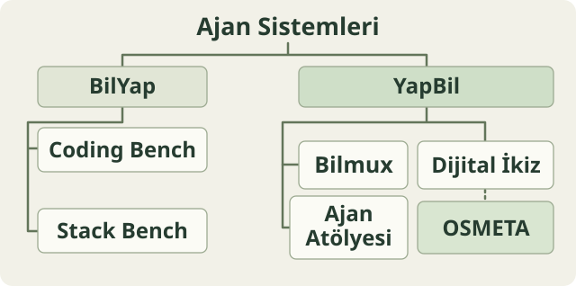

# Orçun Sami Tandoğan

**TR** · Genetik ve biyoinformatikten geliyorum. Bugün yapay zekâ ajanlarıyla çalışmayı kolaylaştıran araçlar geliştiriyor, modelleri ve araçları aynı görevlerde karşılaştırıyorum.

**EN** · My background is in genetics and bioinformatics. Today I build tools for working with AI agents and compare models and tools on the same tasks.

[OrcunSamiTandogan.com](https://orcunsamitandogan.com/) · [Anla Dene](https://anladene.com/) · [Try2learn](https://try2learn.net/)

## Projeler / Projects

<table>
<tr>
<td width="50%" valign="top">
 <b>PROTOTİP / PROTOTYPE</b>
<h3><code>Dijital İkiz / Digital Twin</code></h3>

Kişisel dijital ikiz üzerine bir geliştirme çalışması. 
An exploration of a personal digital twin.

</td>
<td width="50%" valign="top">
 <b>AJAN OTURUMLARI / AGENT SESSIONS</b>
<h3><code>Bilmux</code></h3>

Terminal oturumlarını projelere göre tek pencerede yönet. 
Manage terminal sessions by project in one window.

</td>
</tr>
<tr>
<td width="50%" valign="top">
 <b>YÖNTEM / METHOD</b>
<h3><code>OSMETA</code></h3>

Ajan takımları için görev dağılımı, bağımsız denetim ve teslim ölçütleri. 
Task delegation, independent review, and acceptance criteria for agent teams.

</td>
<td width="50%" valign="top">
 <b>MASAÜSTÜ / DESKTOP</b>
<h3><code>Ajan Atölyesi / Agent Workshop</code></h3>

Codex, Claude, Pi ve DSH oturumlarını tek pencerede aç. 
Open Codex, Claude, Pi, and DSH sessions in one desktop app.

</td>
</tr>
<tr>
<td width="50%" valign="top">
 <b>MODEL KIYASI / MODEL BENCHMARK</b>
<h3><a href="https://coding-bench.anladene.com/"><code>Coding Bench</code> →</a></h3>

Aynı görevde model puanı, süre ve token kullanımı. 
Model scores, time, and token use on the same coding task.

<a href="https://coding-bench.anladene.com/olcumler">Ölçümler / Results</a> · <a href="https://github.com/OrcunSamiTandogan/coding-bench-tests">Açık testler / Open tests</a>
</td>
<td width="50%" valign="top">
 <b>ARAÇ KIYASI / TOOL BENCHMARK</b>
<h3><a href="https://stack-bench.anladene.com/"><code>Stack Bench</code> →</a></h3>

Aynı işi farklı araçlarla yap; sonuçları yan yana gör. 
Compare tools on the same task, with demos and conditions side by side.

<a href="https://stack-bench.anladene.com/kiyas/remotion-hyperframes">Remotion ve / vs. HyperFrames</a>
</td>
</tr>
</table>
