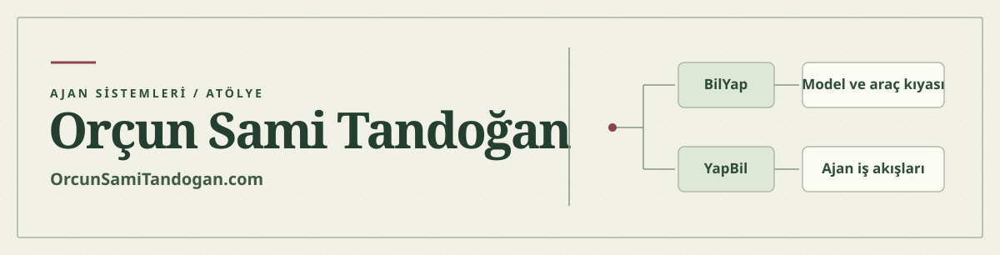

# Orçun Sami Tandoğan

Ajan takımları kuruyorum. Modelleri ve araçları aynı işte ölçüyor, öğrendiklerimi Türkçe anlatıyorum.

[OrcunSamiTandogan.com](https://orcunsamitandogan.com/) · [Anla Dene](https://anladene.com/) · [Try2learn](https://try2learn.net/)

## Buradan başla

<table>
<tr>
<td width="50%" valign="top">
BİLYAP · MODEL KIYASI
<h3><a href="https://coding-bench.anladene.com/">Coding Bench</a></h3>

Aynı kodlama görevinde modeller ve efor ayarları. Hangi yanıt testten geçti, ne kadar sürdü, kaç token ölçüldü?

<a href="https://coding-bench.anladene.com/olcumler">Ölçüm sonuçları →</a> · <a href="https://github.com/OrcunSamiTandogan/coding-bench-tests">Açık testleri tekrar et →</a>
</td>
<td width="50%" valign="top">
BİLYAP · ARAÇ KIYASI
<h3><a href="https://stack-bench.anladene.com/">Stack Bench</a></h3>

Aynı işi farklı araçlarla yapmanın sonuçları. Demosu, süreleri ve deney koşulları yan yana.

<a href="https://stack-bench.anladene.com/kiyas/remotion-hyperframes">Remotion ve HyperFrames deneyi →</a>
</td>
</tr>
<tr>
<td width="50%" valign="top">
ÖĞREN VE DENE
<h3><a href="https://anladene.com/">Anla Dene</a></h3>

Yapay zekâyı Türkçe, uygulamalı örneklerle öğren. İlk ajan iş akışını adım adım kur.

<a href="https://anladene.com/courses/">Kurslara bak →</a>
</td>
<td width="50%" valign="top">
YAPBİL · YAYINA HAZIRLANIYOR
<h3>Bilmux</h3>

Ajanların tmux oturumlarını projelere göre tek pencerede yönet. Terminal bölmelerini yan yana aç.

</td>
</tr>
</table>

## Atölyede

- **Dijital İkiz** · Kişisel dijital ikiz üzerine geliştirme çalışması.
- **OSMETA** · Ajan takımlarında iş dağılımını, bağımsız denetimi ve teslimin kabul koşullarını tanımlayan çalışma yöntemi.
